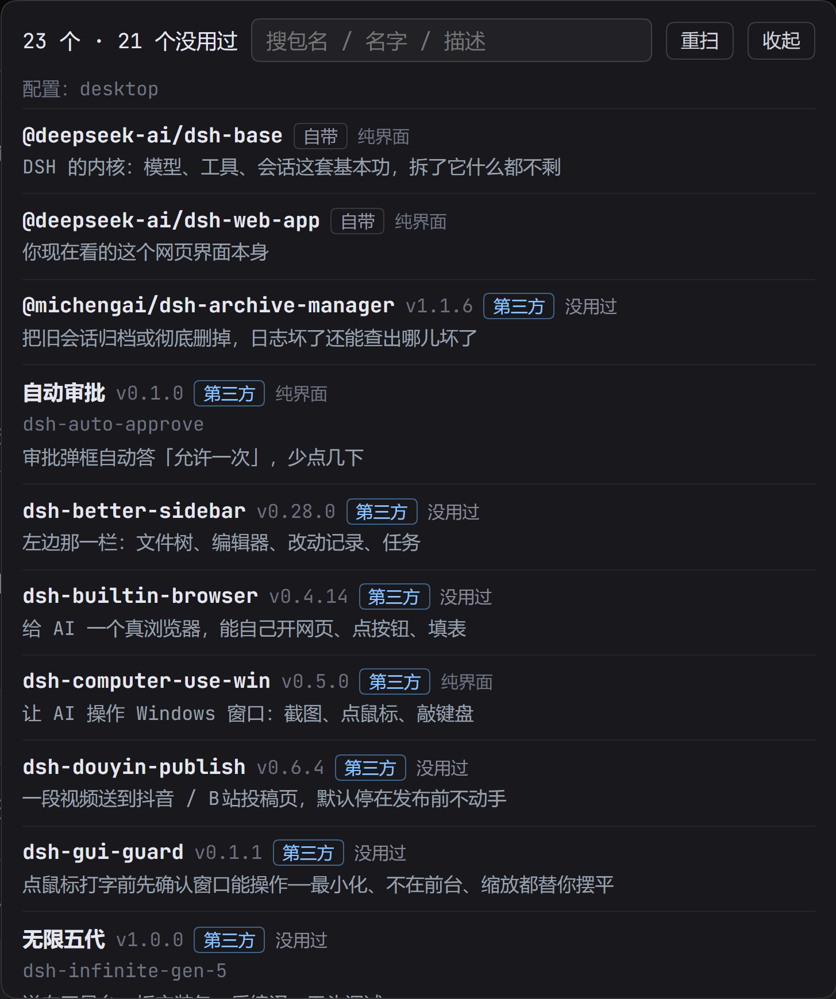

# dsh-my-plugins（我装的插件）

**顶栏一颗药丸：「我装的插件 · 23」。点开是你这个 DSH 到底装了什么。**

每个插件一行：它的名字、版本、作者自己写的一句作用，自带的还是第三方，
带搜索框——装到三十几个以后靠翻是翻不完的。



## 为什么会有这个东西

装了二十几个插件之后，界面上的变化你天天看得见，但**谁也说不清到底装了什么**：
市场里点过的、朋友推荐的、自己 link 进来的，全混在一起。

所以这颗药丸只回答一个问题：**我现在到底装了什么，它们各自是干什么的。**

## 它怎么知道

读 **当前 profile 的 `package.json`**——`dsh.profile.bundles` 是真正被加载的名单，
`dependencies` 给声明的版本，实装版本看 `node_modules/<包名>/package.json`。

不去扫目录猜，也不用你填任何东西。插件的一句话作用取自它自己的 `package.json`，
**作者怎么写就怎么显示**，我们不替它编、不翻译、不打分。

## 安装

```bash
dsh plugin --profile web add dsh-my-plugins
```

或者从市场里点安装。

## 你会看到什么

- 顶部药丸：`我装的插件 · N`，N 是实际加载的插件数（不含自己）
- 面板：`N 个 · 第三方 M`
- 每行：名字 · 版本 · `自带` / `第三方` · 一句描述
- 搜索框：按包名、名字、描述都能搜
- 「重扫」按钮：刚装完新插件不想重启时，强制重读一次

## 边界

- **只读**：不改 profile、不动插件文件、不联网
- 一个无参 GET 接口 `/dsh-my-plugins/report`，60 秒缓存，`?force=1` 强刷
- 读不到某个包的 `package.json` 时留空，不报错、不影响其他行

## 已知的限制

- 只在 **web / desktop 界面**有这个药丸；纯 CLI profile 看不到（但接口在）
- 显示的是"被加载的插件"，不含 DSH 内置的宿主能力
- 第三方插件的描述如果是英文，就显示英文——那是作者写的，我们不改

## License

MIT
